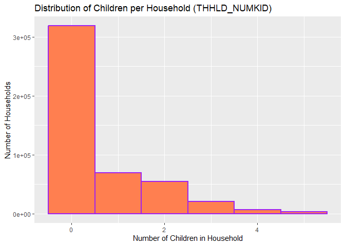
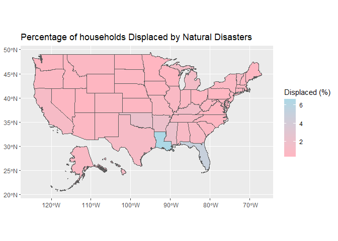

# Geog4/6300: Lab 4


- [<span class="toc-section-number">1</span> One and two sample
  difference tests](#one-and-two-sample-difference-tests)
- [<span class="toc-section-number">2</span> Assessment
  criteria](#assessment-criteria)
  - [<span class="toc-section-number">2.1</span> Loading/filtering data
    and checking for
    normality.](#loadingfiltering-data-and-checking-for-normality)
  - [<span class="toc-section-number">2.2</span> Testing the difference
    in number of
    children.](#testing-the-difference-in-number-of-children)
  - [<span class="toc-section-number">2.3</span> Identifying differences
    in time displaced by natural disasters across income
    groups](#identifying-differences-in-time-displaced-by-natural-disasters-across-income-groups)
  - [<span class="toc-section-number">2.4</span> Challenge
    Question:](#challenge-question)
  - [<span class="toc-section-number">2.5</span> Final submission
    stuff](#final-submission-stuff)

## One and two sample difference tests

**Overview:** In this lab, you’ll be doing analysis with public use
microdata from the Household Pulse survey administered by the U.S.
Census Bureau during the COVID pandemic. The survey had a particular
focus on pandemic effects on health and wellbeing, but it also included
questions on the impact of natural disasters on households. That’s the
section you’ll be focusing on here.

Unlike the aggregate census data you’re probably used to working with,
microdata provide anonymized individual-level responses that researchers
can use to calculate their own summary statistics and estimates.

There’s more info on the Pulse survey and the public use microdata file
at this link:

- [Household Pulse Survey Public Use
  Files](https://www.census.gov/programs-surveys/household-pulse-survey/data/datasets.html)

The main data are contained in the `pulse_2023` csv file in the data
folder. The data dictionary for this dataset is also available in the
data folder.

You’ll use this data to answer two research questions:

- Did households displaced by natural disasters include more children
  than those not displaced?
- Is there a relationship between household income and a household’s
  ability to return to its place of residence after being displaced?

## Assessment criteria

This lab assesses the following learning standards:

21. Assess the normality of a variable and use those results to select
    between parametric and non-parametric statistical tests.
22. Apply two-sample tests of difference and accurately interpret
    results in terms of hypothesis testing, statistical significance,
    and the direction and magnitude of any differences.
23. Construct contingency tables and apply chi-square tests to assess
    association between categorical variables, interpreting results in
    terms of significance and practical meaning.

### Loading/filtering data and checking for normality.

In the first part of the lab, you’ll be using two variables:
THHLD_NUMKID (number of children in a household) and ND_DISPLACE
(whether a household was displaced by a natural disaster in the last
year).

Load the dataset using read_csv, and also take a look at the two
variables of interest in the data dictionary. For this lab, you only
want observations with valid responses, filtering out records where
respondents did not provide an answer. Filter these data so you have
only valid responses.

**Task 1** *Load the Pulse data and filter it to only valid responses.*

``` r
#Loading and filtering the data to include only valid responses:
pulse_valid_table<-read_csv("data/pulse_2023.csv")
```

    Rows: 539305 Columns: 48
    ── Column specification ────────────────────────────────────────────────────────
    Delimiter: ","
    chr  (2): SCRAM, EST_ST
    dbl (46): WEEK, EST_MSA, REGION, HWEIGHT, PWEIGHT, TBIRTH_YEAR, ABIRTH_YEAR,...

    ℹ Use `spec()` to retrieve the full column specification for this data.
    ℹ Specify the column types or set `show_col_types = FALSE` to quiet this message.

``` r
#Loading in the data dictionary to see what counts as valid. Had to look up how to read an xlsx file in R:
library(readxl)
data_dictionary<-read_excel("data/pulse2023_data.dictionary_CSV.xlsx")
```

    New names:
    • `` -> `...2`
    • `` -> `...3`
    • `` -> `...4`
    • `` -> `...5`
    • `` -> `...6`
    • `` -> `...7`

``` r
#^From this, it looks like for "THHLD_NUMKID" any number from 0-40 is valid, and for "ND_DISPLACE", 1=yes, 2=no, -88=missing, -99=question seen but not reported. So I'll filter those out next below:

pulse_valid_table_filtered<-read_csv("data/pulse_2023.csv") %>%
  filter(THHLD_NUMKID >=0, THHLD_NUMKID <=40, ND_DISPLACE %in% c(1,2))
```

    Rows: 539305 Columns: 48
    ── Column specification ────────────────────────────────────────────────────────
    Delimiter: ","
    chr  (2): SCRAM, EST_ST
    dbl (46): WEEK, EST_MSA, REGION, HWEIGHT, PWEIGHT, TBIRTH_YEAR, ABIRTH_YEAR,...

    ℹ Use `spec()` to retrieve the full column specification for this data.
    ℹ Specify the column types or set `show_col_types = FALSE` to quiet this message.

``` r
#Noting the number of obs went down by a lot. 
```

You’ll be conducting a two-sample test of difference to look at whether
the number of children differs between those displaced and not
displaced. To know which test to use, you have to assess the normality
of the THHLD_NUMKID variable.

**Task 2** *Assess the normality of this variable using either a
histogram OR a qq line. Make sure your plot is visible and interpret
what it shows you about the normality of this variable.*

``` r
#I'll use a histogram, and make it coral & purple bc why not:
ggplot(pulse_valid_table_filtered, aes(x=THHLD_NUMKID)) +
  geom_histogram(binwidth = 1, fill="coral", color = "purple", linewidth = 0.75) + 
  labs(title = "Distribution of Children per Household (THHLD_NUMKID)", x = "Number of Children in Household", y = "Number of Households")
```



``` r
#The histogram shows up to be strongly right-skewed. 
```

### Testing the difference in number of children.

Now you can test whether the number of children differs between
displaced and non-displaced households.

**Task 3** *Based on the normality of the data, what is the appropriate
statistical test for determining whether the number of children differs
between these two groups? Explain why this test is appropriate and give
a null and alternative hypothesis for this test*

The appropriate statistical test to determine whether the number of
children differs between the two groups is the Wilcoxon test (rank-sum
specifically). The data is strongly right-skewed, and with this test
being non-parametric and that we’re comparing two different groups
without directly comparing their means, this test seems appropriate. The
null hypothesis is that the number of children per household is the same
for displaced and non-displaced households, whereas the alternative
hypothesis is that the distribution of the number of children per
household differs between displaced and non-displaced households.

**Task 4** *Run the test you identified in Task 3. Also calculate the
mean for each dataset, which you can use to determine the nature of the
difference–which group (if any) has more children.*

``` r
#Running the test I chose:
wilcox.test(THHLD_NUMKID ~ ND_DISPLACE, data = pulse_valid_table_filtered)
```


        Wilcoxon rank sum test with continuity correction

    data:  THHLD_NUMKID by ND_DISPLACE
    W = 1171425061, p-value = 2.463e-12
    alternative hypothesis: true location shift is not equal to 0

``` r
#Calculating the mean for each dataset:
mean_children_calc<- pulse_valid_table_filtered %>%
  group_by(ND_DISPLACE) %>%
  summarise(mean_children = mean(THHLD_NUMKID), observations = n())
#This made a table with the mean children and number of households for each group. 
```

**Task 5** *Interpret the results of the analysis you did in task 4.* \*
Do you reject the null hypothesis? Why or why not? \* Based on the test
result and the group means, what can we conclude about differences in
the number of children between these two groups?

Since the p-value is extremely small (p-value = 2.463e-12, which is p \<
0.05), this is statistically significant, which means we can reject the
null hypothesis. This means that there’s a statistically significant
difference in the distribution of the number of children between the
displaced and non-displaced households. Essentially, the distribution of
the \# of children differs between houses that were displaced or not by
natural disasters. The difference in mean_children is 0.7472826 -
0.5944313 = 0.1528513, which means that displaced households has ~0.153
more children per household. Displaced household tend to have slightly
more children, on average, compared to non-displaced households.

### Identifying differences in time displaced by natural disasters across income groups

In Part 2, you used a test of difference that included a continuous and
categorical variable. In this section, you’ll focus only on households
displaced by natural disasters to identify statistically significant
differences in time displaced using two categorical variables: one
placing responses into groups by income (INCOME) and the other showing
the time displaced (ND_HOWLONG).

Again, look at the data dictionary to better understand how these two
variables are structured.

**Task 6** *Reload the original, unfiltered Pulse dataset (not the one
you used in parts 1 and 2). Select only observations for households
displaced by a natural disaster using the ND_DISPLACE variable. Then
filter for records with valid responses to INCOME and ND_HOWLONG. Call
the head of the table with `kable` when done.*

``` r
#Loading the original, unfiltered pulse dataset:
pulse_original_unfiltered<- read_csv("data/pulse_2023.csv")
```

    Rows: 539305 Columns: 48
    ── Column specification ────────────────────────────────────────────────────────
    Delimiter: ","
    chr  (2): SCRAM, EST_ST
    dbl (46): WEEK, EST_MSA, REGION, HWEIGHT, PWEIGHT, TBIRTH_YEAR, ABIRTH_YEAR,...

    ℹ Use `spec()` to retrieve the full column specification for this data.
    ℹ Specify the column types or set `show_col_types = FALSE` to quiet this message.

``` r
#Filtering for displaced households with valid responses (INCOME & ND_HOWLONG). I went to check the data dictionary to see which values were valid for each variable:
pulse_original_unfiltered_displaced<- pulse_original_unfiltered %>%
  filter(ND_DISPLACE == 1, #1=yes for "displaced"
         INCOME %in% 1:8, #there were 8 household income categories
         ND_HOWLONG %in% 1:5) #there were 5 categories showing how long a household was displaced
#Display the head:
knitr::kable(head(pulse_original_unfiltered_displaced))
```

| SCRAM | WEEK | EST_ST | EST_MSA | REGION | HWEIGHT | PWEIGHT | TBIRTH_YEAR | ABIRTH_YEAR | RHISPANIC | AHISPANIC | RRACE | ARACE | EEDUC | AEDUC | MS | EGENID_BIRTH | AGENID_BIRTH | GENID_DESCRIBE | SEXUAL_ORIENTATION | THHLD_NUMPER | AHHLD_NUMPER | THHLD_NUMKID | AHHLD_NUMKID | THHLD_NUMADLT | KIDS_LT5Y | KIDS_5_11Y | KIDS_12_17Y | INCOME | ND_DISPLACE | ND_TYPE1 | ND_TYPE2 | ND_TYPE3 | ND_TYPE4 | ND_TYPE5 | ND_HOWLONG | ND_DAMAGE | ND_FDSHRTAGE | ND_WATER | ND_ELCTRC | ND_UNSANITARY | ND_ISOLATE | ND_CRIME | ND_SCAM | MEDICAID | MEDICAID_NO | FDBENEFIT3 | LIVQTRRV |
|:---|---:|:---|---:|---:|---:|---:|---:|---:|---:|---:|---:|---:|---:|---:|---:|---:|---:|---:|---:|---:|---:|---:|---:|---:|---:|---:|---:|---:|---:|---:|---:|---:|---:|---:|---:|---:|---:|---:|---:|---:|---:|---:|---:|---:|---:|---:|---:|
| V560000089 | 56 | 21 | NA | 2 | 1607.2081 | 3016.3389 | 1987 | 2 | 1 | 2 | 1 | 2 | 7 | 2 | 1 | 1 | 2 | 1 | 2 | 2 | 2 | 0 | 2 | 2 | -88 | -88 | -88 | 3 | 1 | -99 | -99 | -99 | -99 | 1 | 1 | 2 | 1 | 1 | 3 | 1 | 1 | 1 | 1 | 3 | -88 | 1 | 2 |
| V560000117 | 56 | 42 | NA | 1 | 3166.8361 | 8755.5654 | 1953 | 2 | 1 | 2 | 1 | 2 | 4 | 2 | 1 | 1 | 2 | 1 | 2 | 3 | 2 | 0 | 2 | 3 | -88 | -88 | -88 | 4 | 1 | -99 | -99 | -99 | -99 | 1 | 1 | 3 | 2 | 1 | 4 | 1 | 3 | 3 | 4 | 3 | -88 | 1 | 1 |
| V560000205 | 56 | 21 | NA | 2 | 828.5883 | 3110.1176 | 1954 | 2 | 1 | 2 | 1 | 2 | 6 | 2 | 5 | 2 | 2 | 2 | 2 | 4 | 2 | 0 | 2 | 4 | -88 | -88 | -88 | 4 | 1 | -99 | 1 | -99 | -99 | -99 | 5 | 4 | 1 | 1 | 4 | 3 | 4 | 1 | 3 | 3 | -88 | 1 | 2 |
| V560000506 | 56 | 26 | 19820 | 3 | 1024.8124 | 950.5055 | 1964 | 2 | 1 | 2 | 1 | 2 | 6 | 2 | 5 | 1 | 2 | 1 | 2 | 1 | 2 | 0 | 2 | 1 | -88 | -88 | -88 | 6 | 1 | -99 | -99 | -99 | -99 | 1 | 1 | 2 | 1 | 1 | 3 | 1 | 2 | 1 | 1 | 3 | -88 | 1 | 2 |
| V560000603 | 56 | 45 | NA | 2 | 1084.5817 | 2045.7398 | 1971 | 2 | 1 | 2 | 1 | 2 | 6 | 2 | 1 | 1 | 2 | 1 | 2 | 2 | 2 | 0 | 2 | 2 | -88 | -88 | -88 | 8 | 1 | 1 | -99 | -99 | -99 | -99 | 1 | 1 | 1 | 1 | 2 | 1 | 1 | 1 | 4 | 3 | -88 | 1 | 2 |
| V560000686 | 56 | 37 | NA | 2 | 650.4371 | 636.1618 | 1969 | 2 | 1 | 2 | 1 | 2 | 5 | 2 | 3 | 2 | 2 | 2 | 2 | 2 | 2 | 1 | 2 | 1 | -99 | -99 | 1 | 1 | 1 | -99 | -99 | -99 | 1 | -99 | 5 | 4 | 3 | 1 | 2 | 1 | 1 | 1 | 1 | -88 | -88 | 1 | 3 |

**Task 7** *Create a contingency table of responses to the ND_HOWLONG
variable by INCOME. The rows of this table should be the income groups
and the columns should be the categorical variables showing time
displaced. Call the table when you are done.*

``` r
#Making the contingency table of responses to the ND_HOWLONG variable by INCOME:
contingency_table<- table(pulse_original_unfiltered_displaced$INCOME, pulse_original_unfiltered_displaced$ND_HOWLONG)

contingency_table
```

       
          1   2   3   4   5
      1 286 218 115  69 179
      2 162 122  50  23  63
      3 221 135  67  32  50
      4 316 160  78  42  52
      5 219 107  54  23  33
      6 317 115  58  37  37
      7 142  54  22   8  11
      8 223  64  45  35  43

**Task 8** *Run a chi-square test on your contingency table to assess
whether there are statistically significant differences in displacement
time between these income groups. You’ll likely need to delete the
INCOME variable to do so.*

``` r
chisq_test<- chisq.test(contingency_table)
#to show them here:
chisq_test
```


        Pearson's Chi-squared test

    data:  contingency_table
    X-squared = 210.51, df = 28, p-value < 2.2e-16

``` r
#Results:
#X-squared = 210.51, df = 28, p-value < 2.2e-16
```

**Task 9** *To help with your interpretation of results, Calculate the
percentage of households within each income group that fall into
category 1 of ND_HOWLONG (“displaced less than a week”).*

``` r
#Calculating the percentage of households within each income group that fall into category 1. I think I am supposed to use the task 6 dataframe for this:
incomepct_cat1<- pulse_original_unfiltered_displaced %>%
  group_by(INCOME) %>%
  summarise(
    total_households = n(),
    less_than_week_cat1 = sum(ND_HOWLONG ==1),
    percentage = (less_than_week_cat1 / total_households)*100)
#I'll show the table here too:
knitr::kable(incomepct_cat1)
```

| INCOME | total_households | less_than_week_cat1 | percentage |
|-------:|-----------------:|--------------------:|-----------:|
|      1 |              867 |                 286 |   32.98731 |
|      2 |              420 |                 162 |   38.57143 |
|      3 |              505 |                 221 |   43.76238 |
|      4 |              648 |                 316 |   48.76543 |
|      5 |              436 |                 219 |   50.22936 |
|      6 |              564 |                 317 |   56.20567 |
|      7 |              237 |                 142 |   59.91561 |
|      8 |              410 |                 223 |   54.39024 |

**Task 10** *Interpret the results of your analysis in tasks 8 and 9.*
\* Do you reject the null hypothesis based on these results and why (or
why not)? \* What do your results in Task 9 tell you about differences
in how quickly households were able to return?

Based on my results in task 8 I would reject the null hypothesis because
the p-value after running the Chi-Squared test is super small (p-value
\<2.2e-16). This, one, tells me the significance level is below 0.05,
and two, this means that there’s statistical significance between
household incomes and the amount of time those households were displaced
by natural disasters. So, displacement duration is going to differ
across the income categories, which is evident in the task 9 table.
Based on the percentages within the table, there is a trend of
higher-income households being displaced for shorter amount of time (aka
less than a week), so that tells me those households would we have to
return sooner than those lower-income households.

### Challenge Question:

Calculate and map the percentage of households reporting displacement
(ND_DISPLACE) by state. To do so, you’ll need to start with a version of
the dataset that excludes non-valid responses and then calculate the
percentage displaced by state.

Once you’ve calculated that estimate, map it out using the
`states_albers` geopackage file in the data folder. Provide a brief
description of the patterns you observe.

``` r
#Filtering first:
pulse_displace_good<- pulse_original_unfiltered %>%
  filter(ND_DISPLACE %in% c(1,2))
#Calculating the % of households displaced by state:
pct_dis_by_state<- pulse_displace_good %>%
  group_by(EST_ST) %>% #NOTE the EST_ST is fips codes!
  summarise(
    total_households = n(),
    displaced_households = sum(ND_DISPLACE == 1),
    percent_displaced = (displaced_households/total_households)*100)
knitr::kable(pct_dis_by_state)
```

| EST_ST | total_households | displaced_households | percent_displaced |
|:-------|-----------------:|---------------------:|------------------:|
| 01     |             6503 |                   64 |         0.9841612 |
| 02     |             6444 |                   58 |         0.9000621 |
| 04     |            12654 |                   79 |         0.6243085 |
| 05     |             6511 |                  137 |         2.1041315 |
| 06     |            31190 |                  369 |         1.1830715 |
| 08     |            12105 |                   93 |         0.7682776 |
| 09     |             7462 |                   46 |         0.6164567 |
| 10     |             4756 |                   20 |         0.4205214 |
| 11     |             6152 |                   31 |         0.5039012 |
| 12     |            15671 |                  783 |         4.9964903 |
| 13     |            11647 |                  114 |         0.9787928 |
| 15     |             4842 |                   63 |         1.3011152 |
| 16     |             9344 |                   40 |         0.4280822 |
| 17     |            10645 |                   93 |         0.8736496 |
| 18     |             8511 |                   73 |         0.8577135 |
| 19     |             8145 |                   34 |         0.4174340 |
| 20     |             8886 |                   51 |         0.5739365 |
| 21     |             7227 |                  113 |         1.5635810 |
| 22     |             6055 |                  402 |         6.6391412 |
| 23     |             5112 |                   29 |         0.5672926 |
| 24     |            10270 |                   44 |         0.4284323 |
| 25     |            10967 |                   51 |         0.4650315 |
| 26     |            13526 |                  195 |         1.4416679 |
| 27     |            10475 |                   40 |         0.3818616 |
| 28     |             5335 |                  115 |         2.1555764 |
| 29     |             8723 |                   82 |         0.9400436 |
| 30     |             5888 |                   40 |         0.6793478 |
| 31     |             7896 |                   31 |         0.3926039 |
| 32     |             6996 |                   38 |         0.5431675 |
| 33     |             6645 |                   34 |         0.5116629 |
| 34     |             8006 |                   50 |         0.6245316 |
| 35     |             8849 |                   72 |         0.8136513 |
| 36     |             8174 |                   58 |         0.7095669 |
| 37     |             8487 |                   42 |         0.4948745 |
| 38     |             4517 |                   19 |         0.4206332 |
| 39     |             8158 |                   46 |         0.5638637 |
| 40     |             7939 |                  176 |         2.2169039 |
| 41     |            12350 |                   88 |         0.7125506 |
| 42     |            11663 |                   55 |         0.4715768 |
| 44     |             4115 |                   18 |         0.4374241 |
| 45     |             7187 |                   51 |         0.7096146 |
| 46     |             5249 |                   32 |         0.6096399 |
| 47     |             8324 |                   89 |         1.0691975 |
| 48     |            22858 |                  270 |         1.1812057 |
| 49     |            12064 |                   41 |         0.3398541 |
| 50     |             5234 |                   66 |         1.2609859 |
| 51     |            12122 |                   50 |         0.4124732 |
| 53     |            20187 |                  104 |         0.5151830 |
| 54     |             5788 |                   40 |         0.6910850 |
| 55     |             8725 |                   34 |         0.3896848 |
| 56     |             5169 |                   21 |         0.4062681 |

``` r
#Loading the geopackage (state boundaries)
library(sf)
```

    Linking to GEOS 3.14.1, GDAL 3.12.1, PROJ 9.7.1; sf_use_s2() is TRUE

``` r
states_boundaries<- st_read("data/states_albers.gpkg") #NOTE that this includes fips codes and state names!
```

    Reading layer `states_albers' from data source 
      `C:\Users\selen\Downloads\geog4300-lab-4sweet\data\states_albers.gpkg' 
      using driver `GPKG'
    Simple feature collection with 51 features and 14 fields
    Geometry type: MULTIPOLYGON
    Dimension:     XY
    Bounding box:  xmin: -124.7332 ymin: 20.63151 xmax: -66.9499 ymax: 49.38436
    Geodetic CRS:  WGS 84

``` r
#I am looking to use a join later, but first I think i have to convert fips codes to state names? Had to do some googling to figure this out, I'm sure there's a better way out there to match fips codes and states names but oh well. 
state_match_table <- data.frame(
  EST_ST = c(
    "01", "02", "04", "05", "06", "08", "09", "10",
    "12", "13", "15", "16", "17", "18", "19", "20",
    "21", "22", "23", "24", "25", "26", "27", "28",
    "29", "30", "31", "32", "33", "34", "35", "36",
    "37", "38", "39", "40", "41", "42", "44", "45",
    "46", "47", "48", "49", "50", "51", "53", "54",
    "55", "56"),STATE = state.name)
#The joining part:
pct_dis_by_state_join<- pct_dis_by_state %>%
  left_join(state_match_table, by = "EST_ST")

pct_boundaries_join<- states_boundaries %>%
  left_join(pct_dis_by_state_join, by = "STATE")

#MAPPING TIME (finally):
library(ggplot2)
ggplot(pct_boundaries_join) +
  geom_sf(aes(fill = percent_displaced)) +
  scale_fill_gradient(
    low = "lightpink",
    high = "lightblue",
    na.value = "lightyellow") +
  labs(title = "Percentage of households Displaced by Natural Disasters", fill = "Displaced (%)")
```



``` r
#I love the cotton candy colors :D
```

### Final submission stuff

**Disclosure of assistance:** Besides class materials, what other
sources of assistance did you use while completing this lab? These can
include input from classmates, relevant material identified through web
searches (e.g., Stack Overflow), or assistance from ChatGPT or other AI
tools. How did these sources support your own learning in completing
this lab?

I used Google to assisting me when converting the FIPS codes to state
names before all of the joining parts (referencing the challenge item
here). I was doing lot’s of trial and error with this part and I
originally got a join table that has all NA’s for the percent displaced.
It was a whole jargon but I eventually just used help from Google to get
it right – Now I know for next time! This supported my own learning in
this lab as I now know a less complicated (yet more tedious) way of
converting these codes to names when the given datasets use different
names when listing states.

**Lab reflection:** How do you feel about the work you did on this lab?
Was it easy, moderate, or hard? What are the biggest things you learned
by completing it?

I’d say this lab on a scale of 1-10 was about a 7. Yes there were lots
of tasks, but they were short. The interpretations of statistical values
took me some time and looking back to slides in order to get a
defensible answer. When my results showed up, I didn’t immediately know
what they meant, which added time into me completing this lab. I also
tackled the challenge item this time, and this was giving me all the
troubles that I sort of listed in the Disclosure of Assistance part. I
originally used tmap and that was taking too long and lots of mistakes;
I ended up using ggplot and should have from the start.
